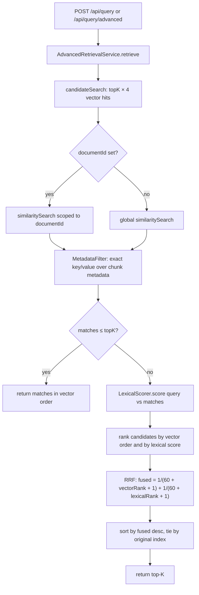

# rag-advanced — Hybrid Retrieval with Metadata Filtering

`rag-advanced` keeps the same API and ingestion pipeline as `rag-basic`, then improves the retrieval stage. It fetches a wider vector candidate set, optionally narrows it with an exact metadata filter, and fuses the vector order with a BM25-style lexical order using Reciprocal Rank Fusion (RRF).

- Port **8082** (`RAG_ADVANCED_PORT`), schema **`rag_advanced`** (`PGVECTOR_ADVANCED_SCHEMA`).
- Extra endpoint: `POST /api/query/advanced` with a metadata filter.
- The standard `POST /api/query` runs the same pipeline with no filter.

## What it actually adds

| Feature | Implemented as | Effect |
|---------|----------------|--------|
| Candidate widening | `topK × 4` vector hits before re-ranking | Gives the lexical pass room to promote good matches |
| Lexical scoring | `LexicalScorer` — BM25-style over the candidate set | Rewards exact/rare term matches vectors blur |
| Rank fusion | RRF over vector order + lexical order | Combines both signals without score normalization |
| Metadata filtering | `MetadataFilter` — exact key/value match | Narrows candidates before fusion |
| Document scoping | `documentId` filter in the store | Same as rag-basic |
| Pipeline variants | Boot + runtime variants | Per-variant chunking, model and table |

**Not implemented (despite older README wording):** cross-encoder/LLM re-ranking, query transformation/expansion, and contextual compression. The implemented re-ranker is the lexical BM25 + RRF pass described below.

## Code map

```
apps/rag-advanced/src/main/java/com/rag/advanced/
├── RagAdvancedApplication.java
├── api/
│   ├── QueryController.java          # /api/query + /api/query/advanced
│   └── AdvancedQueryRequest.java     # question, topK, documentId, metadata
├── config/RagAdvancedConfig.java     # shared pipeline + AdvancedRetrievalService + LexicalScorer
├── retrieval/
│   ├── LexicalScorer.java            # BM25-style scoring over candidates
│   └── MetadataFilter.java           # immutable exact-match predicate
└── services/AdvancedRetrievalService.java
```

`AdvancedRetrievalService` implements `DocumentStorePort`, so the shared `IngestionController` can list/delete documents through it.

## Retrieval pipeline



### 1. Widen the vector pass

```java
int candidateK = topK * CANDIDATE_MULTIPLIER;   // CANDIDATE_MULTIPLIER = 4
vectorStore.similaritySearch(query, candidateK[, documentId]);
```

The adapter underneath further over-fetches for deduplication (up to 4× the requested count; the multiplier stops applying above 256) and removes chunks with identical content. So the effective database fetch can be larger than `topK × 4`, but the re-ranking input is exactly the `candidateK` returned chunks.

### 2. Apply the metadata filter

`MetadataFilter.of(values)` copies the map. Semantics:

- Empty map → matches every chunk (no filtering).
- Otherwise **every** requested key must be present in `chunk.getMetadata()` with an **equal value** (`Objects.equals`). It is exact equality, not substring/range matching, and the value types must match (for example, `"2024"` does not equal `2024`).
- Filtering runs **after** the vector fetch and **before** fusion, so rejected candidates never influence ranks.

### 3. Score lexical relevance

`LexicalScorer` tokenizes with `[\p{L}\p{N}']+`, lower-cases, and computes BM25 over the candidate set only:

```
idf(t)      = ln(1 + (N - df(t) + 0.5) / (df(t) + 0.5))
norm(t, d)  = tf(t, d) * (k1 + 1) / (tf(t, d) + k1 * (1 - b + b * dl(d) / avgdl))
score(d)    = Σ over query terms t present in d: idf(t) * (norm(t, d) + δ)
```

with `k1 = 1.2`, `b = 0.75`, `δ = 0.5`, `N` = candidate count, `df` = candidate document frequency, `dl` = candidate token length, `avgdl` = average candidate length.

Because IDF is computed against the candidates, this is a **local** BM25 signal, not a corpus-wide index. If the query has no tokens or there are no candidates, all lexical scores are zero.

### 4. Fuse the two orders with RRF

Only ranks are fused, so no score normalization is needed:

```
vectorRank[i]  = position of candidate i in the vector result (0-based)
lexicalRank[i] = position of candidate i after sorting by lexical score (0-based)
weight(r)      = 1 / (60 + r + 1)
fused[i]       = weight(vectorRank[i]) + weight(lexicalRank[i])
```

The final result sorts by `fused` descending, breaks ties by the original candidate index, and keeps `topK`.

Two consequences worth knowing:

- **Lexical-only scores never bypass the vector gate.** A chunk must first be in the vector candidate set to be considered.
- **If lexical scores are all equal** (for example, a query whose terms appear nowhere), lexical ranks follow the input order, so the vector ordering is preserved.
- **If the filtered set is already ≤ `topK`**, the service returns it untouched — fusion would not change the membership and is skipped.

## Worked example

`topK = 3`, so the vector pass fetches 12 candidates. After a metadata filter, 8 remain. Lexical scoring promotes a chunk that was ranked 7th by the vector store but 1st lexically:

| Candidate | Vector rank | Lexical rank | Fused (k = 60) | Result |
|-----------|-------------|--------------|----------------|--------|
| A | 0 | 2 | 1/61 + 1/63 ≈ 0.0323 | 1 |
| C | 1 | 4 | 1/62 + 1/65 ≈ 0.0315 | 2 |
| B | 7 | 0 | 1/68 + 1/61 ≈ 0.0311 | 3 |

The exact ordering depends on real scores; the point is that a strong lexical match can move up without discarding the vector signal.

## Chat vs query

`rag-advanced` still wires the shared `ChatService` to `/ws/chat`, and `ChatService` retrieves with the vector store directly. Therefore:

- `POST /api/query` and `POST /api/query/advanced` → `AdvancedRetrievalService` (widening + filter + RRF).
- `WS /ws/chat` → shared `ChatService` (plain vector top-K, then prompt + stream).

If you need hybrid retrieval for the chat path too, call `/api/query/advanced` to get the chunks and generate from them, or extend the chat wiring. This is a known asymmetry, not a hidden feature.

## API

```bash
# Standard contract query (advanced pipeline, no metadata filter)
curl -H "Content-Type: application/json" \
  -d '{"question":"What is hybrid retrieval?","topK":4}' \
  http://localhost:8082/api/query

# Advanced query with a metadata filter
curl -H "Content-Type: application/json" \
  -d '{"question":"What is hybrid retrieval?","topK":4,"metadata":{"source":"spring-ai"}}' \
  http://localhost:8082/api/query/advanced

# Scoped to one document + metadata filter
curl -H "Content-Type: application/json" \
  -d '{"question":"summarize section 2","topK":4,"documentId":"<id>","metadata":{"language":"en"}}' \
  http://localhost:8082/api/query/advanced
```

`AdvancedQueryRequest` is `(String question, Integer topK, String documentId, Map<String, Object> metadata)`; a null metadata map becomes empty. `topK` defaults to 5.

Shared ingestion, document management and crawl endpoints are identical to rag-basic.

## Pipeline variants

Same mechanism as rag-basic: the `boot` variant keeps `rag_advanced.chunks`; runtime variants own `rag_advanced.variant_<id>`. Switching a variant changes the chunking/embedding for the next ingestion and query.

| Method | Path |
|--------|------|
| `GET` | `/api/modules/rag-advanced/variants` |
| `GET` | `/api/modules/rag-advanced/variants/active` |
| `POST` | `/api/modules/rag-advanced/variants` |
| `POST` | `/api/modules/rag-advanced/variants/{variantId}/activate` |
| `PUT` / `DELETE` | `/api/modules/rag-advanced/variants/{variantId}` |

## Configuration

| Property | Env var | Default | Description |
|----------|---------|---------|-------------|
| `server.port` | `RAG_ADVANCED_PORT` | `8082` | HTTP port |
| `rag.provider.url` | `RAG_PROVIDER_URL` | `http://localhost:8086` | Chat + embedding hub |
| `rag.webcrawler.url` | `RAG_WEBCRAWLER_URL` | `http://localhost:8085` | URL ingestion |
| `rag.vector-store.type` | `VECTOR_STORE_TYPE` | `pgvector` | `pgvector` or `simple` |
| `rag.chunking.strategy` | - | `recursive` | Boot variant strategy |
| `rag.chunking.size` | `CHUNK_SIZE` | `512` | Boot variant window |
| `rag.chunking.overlap` | `CHUNK_OVERLAP` | `128` | Boot variant overlap |
| `rag.embedding.batch-size` | `RAG_EMBED_BATCH_SIZE` | `100` | Embedding batch window |
| `spring.ai.vectorstore.pgvector.schema-name` | `PGVECTOR_ADVANCED_SCHEMA` | `rag_advanced` | Isolated schema |

## Trade-offs and limits

| Strength | Cost |
|----------|------|
| Exact/rare terms are no longer lost behind embeddings | Extra candidates (≈4×) plus CPU scoring; slower than rag-basic |
| RRF combines two signals without score calibration | BM25 is candidate-local, not corpus-global |
| Metadata filters cut obvious noise before fusion | Exact equality only; no ranges, fuzzy match or nested paths |
| Skips fusion when the filtered set is small | With ≤ `topK` filtered candidates, no lexical re-ranking happens |
| No extra LLM calls | Not a semantic re-ranker; hard paraphrases can still be missed |

Reach for `rag-advanced` when retrieval precision matters but questions are still answerable in one retrieval step. For multi-hop or tool-driven questions, use [rag-agentic](rag-agentic.md).

## Related

- [Module deep dives](README.md)
- [rag-advanced README](../../../apps/rag-advanced/README.md)
- [rag-basic deep dive](rag-basic.md)
- [rag-agentic deep dive](rag-agentic.md)
- [Trade-offs](../../comparison/trade-offs.md)
- [ADR-0015: pipeline variants](../decision-records/adr-0015-pipeline-variants.md)
