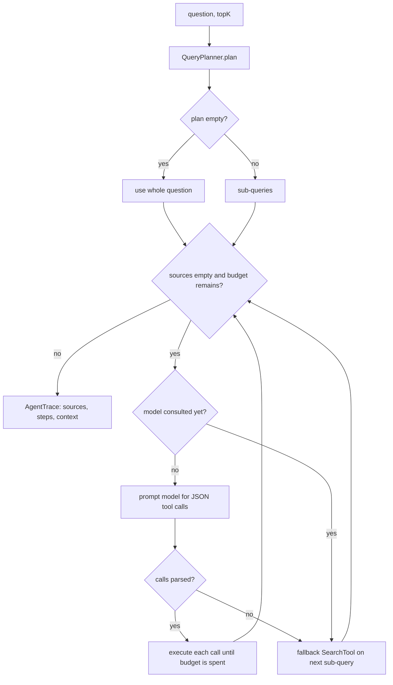

# rag-agentic — Bounded Multi-Step Agent

`rag-agentic` replaces the single retrieval call with a **bounded agent loop**: plan the question into sub-queries, let the chat model pick tools, execute them, reflect on whether the gathered context is enough, and only then answer.

- Port **8083** (`RAG_AGENTIC_PORT`), schema **`rag_agentic`** (`PGVECTOR_AGENTIC_SCHEMA`).
- Default step budget: `rag.agent.max-steps=3`.
- Tool selection is **prompt-based JSON**, not provider-native tool calling, so it works with any chat model behind `rag-provider`.

## What it features

| Feature        | Component                                           | Behaviour                                                                  |
|----------------|-----------------------------------------------------|----------------------------------------------------------------------------|
| Query planning | `QueryPlanner`                                      | Deterministic split of compound questions into sub-queries                 |
| Tool selection | `AgentLoop` + `ToolCallParser`                      | Model returns a JSON array of tool calls; prose around it is tolerated     |
| Tools          | `SearchTool`, `DocumentSearchTool`, `WebSearchTool` | Vector search, document-scoped search, live web fetch                      |
| Fallback       | `ToolRegistry` + `SearchTool`                       | Unknown tool names or unusable model output degrade to plain search        |
| Reflection     | `ReflectionAgent`                                   | Stops as soon as at least one vector source exists, or the budget is spent |
| Trace          | `AgentStep` list                                    | Every tool step is returned to the caller for observability                |
| Answering      | `AgenticChatService`                                | One-shot answer or streaming tokens over the gathered context              |

## Code map

```
apps/rag-agentic/src/main/java/com/rag/agentic/
├── RagAgenticApplication.java
├── domain/          ToolCall, ToolResult, AgentStep, AgentTrace, AgenticConstants
├── agents/
│   ├── QueryPlanner.java       # deterministic decomposition
│   ├── ToolCallParser.java     # balanced-brace JSON extraction
│   └── ReflectionAgent.java    # bounded sufficiency check
├── tools/
│   ├── AgentTool.java          # strategy interface (name + execute)
│   ├── SearchTool.java         # vector search (default + fallback)
│   ├── DocumentSearchTool.java # search scoped to a documentId
│   └── WebSearchTool.java      # fetch a URL via rag-webcrawler
├── orchestration/
│   ├── ToolRegistry.java       # name → tool, with search fallback
│   ├── AgentLoop.java          # the bounded loop + prompts
│   └── AgenticChatService.java # ask / askStream entry points
├── services/AgenticRetrievalService.java
├── config/RagAgenticConfig.java
└── api/             AgenticQueryController, AgentQueryRequest/Response
```

## The loop



### 1. Plan

`QueryPlanner` splits the question on these connectors, in order, de-duplicates the parts while preserving order, and drops blanks:

```
" and "   " then "   " but "   "; "   ";"   "?"   "."
```

A single question yields a one-element plan. `AgentLoop` falls back to the whole question if the plan is empty. This is deliberately deterministic — no extra LLM call is spent on planning.

### 2. Act

On the first iteration the loop asks the chat model for a JSON array of up to `maxSteps` tool calls, using a prompt that lists the available tools:

```
[{"action":"tool","tool":"search","args":{"query":"fast retrieval"}}]
```

`ToolCallParser` then:

1. Extracts balanced `{...}` blocks from the response, ignoring braces inside quoted strings, so prose around the JSON is fine.
2. Tries each block as JSON; skips non-objects and blocks whose `action` is `"answer"`.
3. Reads the tool name from `tool` or `name`, and the arguments `query`, `documentId`, `url`, `topK` from `args` (with top-level fallbacks).
4. Returns an empty list if nothing parseable remains — which triggers the fallback.

`ToolRegistry.resolve(name)` maps names to tools. An unknown (hallucinated) name logs a warning and resolves to `SearchTool`, so the loop degrades instead of failing.

### 3. Fall back deterministically

When the model yields no usable calls, the loop executes `SearchTool` on the next planned sub-query. The index is `min(used, subQueries.size() - 1)`, so extra iterations re-use the last sub-query. This makes the loop bounded and testable even with a weak model.

The model is asked for tools **once per run** (`llmConsulted`); later iterations use the deterministic fallback rather than paying for more tool-selection calls.

### 4. Reflect

`ReflectionAgent.shouldContinue(hasContext, stepsUsed, maxSteps)` returns:

```java
!hasContext && stepsUsed < maxSteps
```

where `hasContext` is `!sources.isEmpty()`. The loop stops at the next reflection check once at least one **vector chunk** has been gathered; all tool calls returned in that same iteration still execute before the check. Two consequences:

- A run usually stops after the first productive iteration, not after exhausting the plan.
- A `web_search`-only run does **not** satisfy reflection by itself, because `WebSearchTool` returns no chunks (only text). The loop continues until a vector source appears or the budget runs out.

### 5. Assemble context and answer

- Tool snippets are appended to a context buffer separated by `\n---\n`.
- Chunks are accumulated as answer sources, de-duplicated by chunk `id`.
- Each execution adds `AgentStep("tool:" + name, detail)`, where `detail` is the snippet clipped to 160 chars (`(no results)` when blank).
- `AgentLoop.run` then calls the chat model with a grounded prompt and returns `AgentTrace(answer, sources, steps, context)`.
- `AgentLoop.collect` returns the same trace with `answer = null`; `AgenticChatService.askStream` uses it to stream the final answer.

Answer prompt:

```
You are a helpful assistant. Answer the question using ONLY the provided
context. If the answer is not in the context, say you do not know.

Context:
<condensed tool output>

Question: <question>
Answer:
```

With no gathered context, the prompt contains an empty context and the model is instructed to say it does not know.

## Tools

| Name | Class | Requires | Returns |
|------|-------|----------|---------|
| `search` | `SearchTool` | `query` | Vector chunks + joined snippets |
| `document_search` | `DocumentSearchTool` | `query` + `documentId` | Document-scoped chunks |
| `web_search` | `WebSearchTool` | `url` | Fetched page text; **no chunks** |

- `topK` per call: `call.topK() > 0 ? call.topK() : rag.agent.tool-top-k` (default `4` in `application.yml`; the bean falls back to `5` if the property is absent).
- A call missing its required argument is ignored with a warning and returns an empty result.
- `web_search` extends the prompt context, but does not add `Chunk` sources to the response because the crawler returns a page, not vector hits.

## Entry points

| Method | Path | Pipeline |
|--------|------|----------|
| `POST` | `/api/query` | `AgenticRetrievalService.retrieve` → `AgentLoop.collect` → returns the gathered chunks (contract `QueryResponse`) |
| `POST` | `/api/query/agentic` | `AgenticChatService.ask` → loop + answer → `{answer, sources, steps}` |
| `WS` | `/ws/chat` | `AgenticChatService.askStream` → loop gathers context, then streams answer tokens |

`topK` defaults to 5. `AgentQueryRequest` is `(String question, Integer topK)`.

### Example

```bash
curl -H "Content-Type: application/json" \
  -d '{"question":"What is hybrid retrieval and how does rag-advanced rank results?","topK":4}' \
  http://localhost:8083/api/query/agentic
```

Response shape:

```json
{
  "answer": "Hybrid retrieval in rag-advanced fuses vector order with a BM25-style lexical order...",
  "sources": [
    {
      "id": "chunk-42",
      "documentId": "report",
      "content": "AdvancedRetrievalService widens the vector pass...",
      "index": 7,
      "metadata": {"documentId": "report", "sourceType": "MARKDOWN"}
    }
  ],
  "steps": [
    {"label": "tool:search", "detail": "AdvancedRetrievalService widens the vector pass..."},
    {"label": "tool:document_search", "detail": "..."}
  ]
}
```

## Pipeline variants

The agent retrieves from the module's active variant, so changing a variant changes what the next agent run can find:

| Method | Path |
|--------|------|
| `GET` | `/api/modules/rag-agentic/variants` |
| `GET` | `/api/modules/rag-agentic/variants/active` |
| `POST` | `/api/modules/rag-agentic/variants` |
| `POST` | `/api/modules/rag-agentic/variants/{variantId}/activate` |
| `PUT` / `DELETE` | `/api/modules/rag-agentic/variants/{variantId}` |

See [ADR-0015](../decision-records/adr-0015-pipeline-variants.md).

## Configuration

| Property | Env var | Default | Description |
|----------|---------|---------|-------------|
| `server.port` | `RAG_AGENTIC_PORT` | `8083` | HTTP port |
| `rag.provider.url` | `RAG_PROVIDER_URL` | `http://localhost:8086` | Chat + embedding hub |
| `rag.webcrawler.url` | `RAG_WEBCRAWLER_URL` | `http://localhost:8085` | `web_search` fetches |
| `rag.agent.max-steps` | `RAG_AGENT_MAX_STEPS` | `3` | Tool-call / step budget |
| `rag.agent.tool-top-k` | `RAG_AGENT_TOOL_TOP_K` | `4` | Default hits per tool call |
| `rag.vector-store.type` | `VECTOR_STORE_TYPE` | `pgvector` | `pgvector` or `simple` |
| `rag.chunking.*` | `CHUNK_SIZE`, `CHUNK_OVERLAP` | `512` / `128` | Boot variant window |
| `spring.ai.vectorstore.pgvector.schema-name` | `PGVECTOR_AGENTIC_SCHEMA` | `rag_agentic` | Isolated schema |

## Trade-offs and limits

| Strength | Cost |
|----------|------|
| Handles compound/multi-hop questions | Highest latency and token cost: tool selection + answer LLM calls |
| Can combine vector store and live web content | Model-dependent tool selection; weak models fall back more often |
| Unknown tools degrade safely | Prompt-based JSON parsing, not native tool calling |
| Bounded and observable (`maxSteps`, trace steps) | Stops at the **first** vector source, so it may not use the whole plan |
| Same ingestion/contract as the other variants | Web pages enter context but never appear as sources |

Keep `rag.agent.max-steps` small for predictable cost, and prefer a stronger local model (for example an 8B model on an 8 GB GPU) or a cloud model when tool selection quality matters.

## Related

- [Module deep dives](README.md)
- [rag-agentic README](../../../apps/rag-agentic/README.md)
- [rag-basic deep dive](rag-basic.md)
- [rag-advanced deep dive](rag-advanced.md)
- [ADR-0010: rag-provider service](../decision-records/adr-0010-rag-provider.md)
- [ADR-0015: pipeline variants](../decision-records/adr-0015-pipeline-variants.md)
