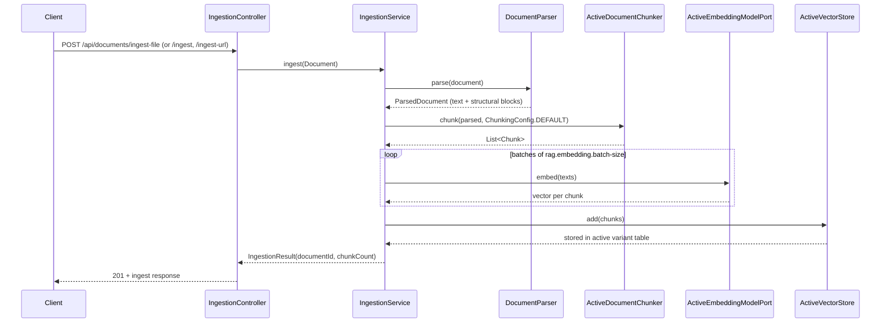
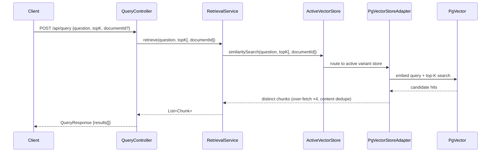
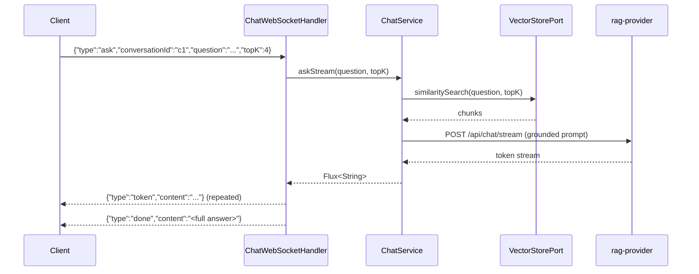

# rag-basic — Baseline RAG

`rag-basic` is the reference implementation: **ingest → chunk → embed → store → retrieve → generate**, with retrieval being a single vector similarity search. It exists to be the control group for `rag-advanced` and `rag-agentic`: same ingestion, same API contract, no retrieval extras.

- Port **8081** (`RAG_BASIC_PORT`), schema **`rag_basic`** (`PGVECTOR_BASIC_SCHEMA`).
- Default chunking: recursive, 512 chars / 128 overlap.
- Default store: PgVector (`VECTOR_STORE_TYPE=simple` switches to in-memory).

## What it features

| Feature              | Implementation                                                | Notes                                                   |
|----------------------|---------------------------------------------------------------|---------------------------------------------------------|
| Baseline retrieval   | `RetrievalService` → `VectorStorePort.similaritySearch`       | Raw vector order, no re-ranking                         |
| Per-document scoping | `similaritySearch(query, topK, documentId)`                   | Filter expression `documentId == '...'` in the store    |
| Contract endpoint    | `POST /api/query` → `QueryResponse`                           | Returns chunks only, no generated answer                |
| Streaming chat       | `/ws/chat` → shared `ChatService`                             | Grounded answer over raw top-K chunks                   |
| Ingestion            | Shared `IngestionController`                                  | File, raw content, URL, async file jobs, crawl sessions |
| Chunking variants    | `ActiveDocumentChunker`                                       | `fixed`, `recursive`, `token`, `semantic` via variants  |
| Document management  | Shared controller + `RetrievalService` as `DocumentStorePort` | List / delete via the active variant store              |
| Observability        | Actuator + Micrometer                                         | `/actuator/health`, `/actuator/prometheus`              |

It deliberately does **not** do re-ranking, hybrid search, metadata filtering, query transformation or multi-step retrieval. That is the point of the baseline.

## Code map

```
apps/rag-basic/src/main/java/com/rag/basic/
├── RagBasicApplication.java
├── api/QueryController.java          # POST /api/query
├── config/RagBasicConfig.java        # imports shared pipeline + WS, wires retrieval + crawler
└── services/RetrievalService.java    # DocumentStorePort + similarity search facade
```

Everything else comes from shared modules:

| Shared bean                                                               | Source                                        |
|---------------------------------------------------------------------------|-----------------------------------------------|
| `IngestionController`, `IngestionService`, `AsyncIngestionService`, crawl | `rag-common-ingestion`                        |
| `ChatService`, `ChatWebSocketHandler`                                     | `rag-common-generation`                       |
| `VectorStorePort`, `PgVectorStoreAdapter`, `InMemoryVectorStore`          | `rag-common-core` / `rag-common-retrieval`    |
| Parser, variants, stores, chat wiring                                     | `rag-common-app` (`RagPipelineConfiguration`) |

`QueryController` maps each `Chunk` to a contract `ChunkResult` (`id`, `documentId`, `content`, `index`, `metadata`) and wraps them in `QueryResponse`.

## How ingestion works



1. The parser keeps source structure (pages, sections, JSON paths) as blocks; an empty extraction is rejected with `EmptyExtractionException`.
2. The active variant's format-aware chunker groups those blocks and splits with the variant's window; chunks carry `documentId`, `index` and provenance metadata.
3. Embeddings are produced in windows of `rag.embedding.batch-size` and attached to the chunks.
4. The active store writes them. For PgVector, `PgVectorStoreAdapter` adds `documentId` and `index` to the Spring AI metadata so per-document filters and listing work.

Async ingestion uses `ingest-file-async` + `GET /api/documents/ingest-status/{documentId}`; the work runs on virtual threads behind a concurrency limiter.

## How retrieval works



- `topK` defaults to **5** in the controller.
- Without `documentId`, the search spans the whole active variant table.
- With `documentId`, the adapter adds `filterExpression("documentId == '...'")`.
- The result is ordered by the store's vector similarity; `rag-basic` adds no post-processing.
- `RetrievalService` also implements `DocumentStorePort` (`listDocuments`, `delete`) so the shared ingestion controller can expose `/api/documents`.

## How chat works



The shared `ChatService` builds this prompt:

```
You are a helpful assistant. Answer the question using ONLY the provided
context. If the answer is not in the context, say you do not know.

Context:
<chunk 1>
---
<chunk 2>

Question: <question>
Answer:
```

If retrieval returns nothing, the context becomes `(no context retrieved)`. `cancel` (or a disconnect) disposes the stream. Because `rag-basic` uses the shared `ChatService`, chat retrieval is always plain vector top-K.

## API

Shared ingestion and document management:

| Method   | Path                                        | Purpose                             |
|----------|---------------------------------------------|-------------------------------------|
| `POST`   | `/api/documents/ingest-file`                | Multipart file ingest (sync)        |
| `POST`   | `/api/documents/ingest-file-async`          | Multipart file ingest (async job)   |
| `GET`    | `/api/documents/ingest-status/{documentId}` | Async job status                    |
| `POST`   | `/api/documents/ingest`                     | Ingest raw content / bytes          |
| `POST`   | `/api/documents/ingest-url`                 | Fetch + ingest via `rag-webcrawler` |
| `GET`    | `/api/documents`                            | List ingested documents             |
| `DELETE` | `/api/documents/{documentId}`               | Delete a document                   |
| `POST`   | `/api/documents/crawl`                      | Start a crawl session               |
| `POST`   | `/api/documents/crawl/{sessionId}/step`     | Advance one crawl step              |
| `DELETE` | `/api/documents/crawl/{sessionId}`          | Cancel a crawl                      |

rag-basic-specific:

| Method | Path         | Purpose                 |
|--------|--------------|-------------------------|
| `POST` | `/api/query` | Top-K similarity search |
| `WS`   | `/ws/chat`   | Streaming grounded chat |

The full contract is [rag-api.yaml](../../../apps/rag-contract/src/main/resources/openapi/rag-api.yaml).

```bash
# Ingest and query
curl -F "file=@docs/report.pdf" http://localhost:8081/api/documents/ingest-file

curl -H "Content-Type: application/json" \
  -d '{"question":"What is this document about?","topK":4}' \
  http://localhost:8081/api/query

# Scope to one document
curl -H "Content-Type: application/json" \
  -d '{"question":"summarize section 2","topK":4,"documentId":"<id>"}' \
  http://localhost:8081/api/query
```

## Pipeline variants

A variant switch changes the chunker, embedding model and storage table used by the **next** ingestion and query. The `boot` variant keeps the module's `chunks` table; runtime variants get `variant_<id>` in `rag_basic`.

```bash
# Register a fixed-window variant, then activate it
curl -H "Content-Type: application/json" \
  -d '{"strategy":"FIXED","embeddingModel":"nomic-embed-text","embeddingDimension":768,"chunkSize":256,"chunkOverlap":32}' \
  http://localhost:8081/api/modules/rag-basic/variants

curl -X POST http://localhost:8081/api/modules/rag-basic/variants/<variantId>/activate
```

`semantic` variants embed with their own provider model, so cut boundaries and stored vectors agree. See [ADR-0015](../decision-records/adr-0015-pipeline-variants.md).

## Configuration

| Property                                     | Env var                 | Default                 | Description              |
|----------------------------------------------|-------------------------|-------------------------|--------------------------|
| `server.port`                                | `RAG_BASIC_PORT`        | `8081`                  | HTTP port                |
| `rag.provider.url`                           | `RAG_PROVIDER_URL`      | `http://localhost:8086` | Chat + embedding hub     |
| `rag.webcrawler.url`                         | `RAG_WEBCRAWLER_URL`    | `http://localhost:8085` | URL ingestion            |
| `rag.vector-store.type`                      | `VECTOR_STORE_TYPE`     | `pgvector`              | `pgvector` or `simple`   |
| `rag.chunking.strategy`                      | -                       | `recursive`             | Boot variant strategy    |
| `rag.chunking.size`                          | `CHUNK_SIZE`            | `512`                   | Boot variant window      |
| `rag.chunking.overlap`                       | `CHUNK_OVERLAP`         | `128`                   | Boot variant overlap     |
| `rag.embedding.batch-size`                   | `RAG_EMBED_BATCH_SIZE`  | `100`                   | Embedding batch window   |
| `spring.ai.vectorstore.pgvector.schema-name` | `PGVECTOR_BASIC_SCHEMA` | `rag_basic`             | Isolated schema          |
| `rag.ingestion.max-concurrent`               | -                       | `2`                     | Async ingest concurrency |

## Trade-offs and limits

| Strength                                    | Cost                                            |
|---------------------------------------------|-------------------------------------------------|
| Cheapest and fastest retrieval path         | No re-ranking: borderline vector hits survive   |
| Smallest module surface (two local classes) | Pure semantic matching can miss exact terms     |
| Easy to reason about and benchmark          | No metadata filtering or query planning         |
| Same ingestion/chat as the other variants   | Chat and query do not use each other's strategy |

Use it as the baseline, for low-stakes retrieval, or when latency and cost dominate. Move to [rag-advanced](rag-advanced.md) when keyword precision matters, and to [rag-agentic](rag-agentic.md) when the question needs multiple steps.

## Related

- [Module deep dives](README.md)
- [rag-basic README](../../../apps/rag-basic/README.md)
- [rag-advanced deep dive](rag-advanced.md)
- [rag-agentic deep dive](rag-agentic.md)
- [Architecture overview](../overview.md)
- [ADR-0006: data store isolation](../decision-records/adr-0006-data-store-isolation.md)
- [ADR-0015: pipeline variants](../decision-records/adr-0015-pipeline-variants.md)
